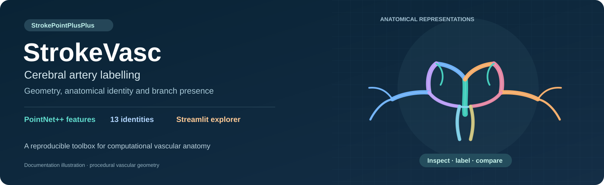
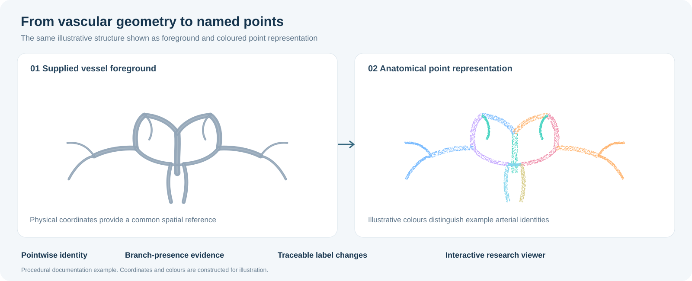

<p align="center">
  
</p>

<p align="center">
  <a href="#quick-start">Quick start</a> ·
  <a href="#interactive-app">Interactive app</a> ·
  <a href="#online-deployment">Online deployment</a> ·
  <a href="#model-inference">Model inference</a> ·
  <a href="#repository-guide">Repository guide</a>
</p>

# StrokeVasc

### Geometric learning for cerebral artery labelling

**StrokeVasc connects point-cloud anatomy with branch-presence evidence.** The
toolbox combines a PointNet++-derived encoder, candidate-level feature pooling
and regularized presence classifiers to assign anatomical identities within a
supplied binary vessel foreground. A Streamlit explorer brings model comparisons,
branch-level summaries and three-dimensional visual inspection into one interface.

The repository is named **StrokePointPlusPlus**, and its Python package is
`strokepointpp`. The app retains **StrokePoint++** component labels for compatibility
with the saved configurations and model assets.

**Research focus:** cerebral arterial identity labelling, anatomical variation
and reproducible vascular-image analysis.

## Why use StrokeVasc

| Capability | What it enables |
| --- | --- |
| **Multiscale geometric representation** | Connect local vessel shape with the wider arterial configuration using a PointNet++-derived encoder. |
| **Branch-aware anatomical naming** | Aggregate candidate evidence for posterior communicating arteries and the accessory third-A2 branch, then condition the eligible point labels. |
| **Modular model interfaces** | Work with the geometric route, a volumetric image model and simple image–point fusion through documented input and output contracts. |
| **Interactive exploration** | Browse cohort-specific summaries, compare fixed methods and inspect branch support in a lightweight Streamlit app. |
| **Traceable evaluation** | Examine overlap alongside absent-class false positives, rare-branch retention and corrected/newly incorrect point counts. |
| **Reproducible engineering** | Use versioned configurations, asset hashes, explicit input schemas and data-independent tests. |

<p align="center">
  
</p>

*Purpose-built documentation illustrations show procedural vascular geometry
and example labels. [Visual provenance and regeneration](docs/README_VISUALS.md).*

## How the method works

1. **Prepare the geometry.** Start with a vessel foreground and spatially aligned
   coordinates. The documented point route uses 2,048 sampled locations per scan.
2. **Encode anatomical context.** Extract local and multiscale features using the
   fixed PointNet++-derived encoder and the corresponding geometric descriptors.
3. **Pool candidate evidence.** Summarize predicted class candidates through mean
   and maximum feature pooling to form 256-dimensional representations.
4. **Estimate branch presence.** Apply the saved standardizers and logistic heads
   to obtain Pcom and third-A2 presence probabilities.
5. **Condition and inspect labels.** Use the fixed presence policy to determine
   eligible anatomical names, then inspect point labels and branch-level outputs.

Named vascular geometry can provide inputs for studies of circle-of-Willis
variation, branch-specific measurements and anatomy-linked physiological models.
Stroke-oriented digital twins and collateral-circulation studies are potential
downstream research applications with their own validation requirements.

## Quick start

### 1. Get the repository

```bash
git clone https://github.com/shumao469/StrokePointPlusPlus.git
cd StrokePointPlusPlus
```

### 2. Inspect the package

The metadata CLI uses Python 3.10 or later and the Python standard library.

```bash
python -m pip install -e .
python -m strokepointpp inspect
python -m strokepointpp summary
python -m strokepointpp verify
```

`inspect` describes the packaged release, `summary` prints its aggregate evidence
record, and `verify` checks files against the active SHA256 manifest. Detailed
research records and version-specific definitions accompany these commands.

## Interactive app

The **Streamlit research explorer** runs on the CPU using the packaged aggregate
tables and presentation assets. This route is convenient for browsing the
project before preparing a model-inference environment.

### Windows PowerShell

```powershell
py -3.12 -m venv .venv-app
./.venv-app/Scripts/python.exe -m pip install -r requirements-app.txt
./.venv-app/Scripts/python.exe -m streamlit run apps/streamlit_app.py --server.address 127.0.0.1 --server.port 8851 --browser.gatherUsageStats false
```

### Linux or WSL

```bash
python3.12 -m venv .venv-app
.venv-app/bin/python -m pip install -r requirements-app.txt
.venv-app/bin/python -m streamlit run apps/streamlit_app.py --server.address 127.0.0.1 --server.port 8851 --browser.gatherUsageStats false
```

Open **[http://127.0.0.1:8851/](http://127.0.0.1:8851/)** after the server starts.
The address serves the app on the hosting computer. Choose another port, such
as `8852`, when running a second local instance.

### Explore the interface

| App area | Available interaction |
| --- | --- |
| **Reviewed results** | Select a cohort and compare fixed methods, intervals and point-change summaries. |
| **Rare branches** | Inspect branch-specific recall, presence support and absent-class false positives. |
| **Figures & cases** | Browse the illustration assets packaged with the selected release. |
| **Local points** | Visualize an operator-enabled, authorized local NPZ point cloud with optional supplied labels. |
| **Development update** | Explore separately versioned model/policy comparisons and dense-grid summaries. |
| **Limitations** | Read the study scope, endpoint definitions and validation context. |

The optional local viewer accepts `xyz` or `points` with shape `N x 3` and optional
integer `labels` with shape `N`. Its local-session setup, privacy controls and
8 MiB input budget are described in [DEPLOYMENT.md](DEPLOYMENT.md#optional-opt-in-local-npz-viewer).
The Streamlit explorer presents results and visualizations; model execution uses
the separate inference interface below.

## Online deployment

### Streamlit Community Cloud

Deploy your own viewer from this repository through
**[Streamlit Community Cloud](https://share.streamlit.io/)**:

| Deployment setting | Value |
| --- | --- |
| Repository | `shumao469/StrokePointPlusPlus` |
| Branch | `main` |
| Main file path | `apps/streamlit_app.py` |
| Python version | `3.12` |
| Dependency entry | `apps/requirements.txt`, which includes `requirements-app.txt` |
| Public app content | Reviewed aggregate tables, approved presentation assets and application code |

Connect GitHub, choose **Create app**, enter the settings above and select the
Python version under **Advanced settings**. After successful deployment,
Streamlit supplies the app's shareable `.streamlit.app` address. The repository
provides the deployment configuration; Community Cloud creates the hosted URL
for your deployment.

For public hosting, use the packaged viewer configuration with local uploads
disabled. Keep research data and authorized model assets in the appropriate
private environment. See the [official deployment guide](https://docs.streamlit.io/deploy/streamlit-community-cloud/deploy-your-app/deploy)
and the [project deployment reference](DEPLOYMENT.md).

## Model inference

Inference uses **prepared NPZ inputs** together with explicitly bound model
assets. Create a separate environment, install the appropriate official PyTorch
build for your CPU/CUDA setup, then install the inference extras:

```bash
python -m pip install -e ".[inference]"
```

Use [the asset-map example](configs/model_assets.local.example.json) to create
your own `model_assets.local.json`. Each logical asset ID maps to its authorized
local file; SHA256 checks bind the numerical state to the saved configuration.

```bash
python -m strokepointpp verify --assets model_assets.local.json

python -m strokepointpp infer --method gate --assets model_assets.local.json --input prepared_gate.npz --output gate_prediction.npz --device cpu

python -m strokepointpp infer --method 3d --assets model_assets.local.json --input prepared_spatial.npz --output three_d_prediction.npz --device cuda:0 --fold 0

python -m strokepointpp infer --method fuse --assets model_assets.local.json --input prepared_spatial.npz --output fusion_prediction.npz --device cuda:0 --fold 0
```

| Route | Main components | Role |
| --- | --- | --- |
| **StrokeVasc Gate** | Fixed PointNet++-derived features, candidate pooling and two presence heads | Geometry-based identity and branch-presence conditioning |
| **Strong3D** | 3D U-Net architecture, physical image patches and point readout | Volumetric image comparator |
| **Simple concatenation** | Image features combined with point-encoder features | Image–point fusion comparator |
| **Semantic-probability interface** | Source-specific heads and probability aggregation | Separately versioned research interface described in the [benchmark note](docs/benchmark_update_20261101.md) |

The Gate command uses its four fixed encoder sources. Spatial `--fold 0` selects
one locked checkpoint; the protocol-level two-fold comparison averages the
corresponding models' logits. Returned scores describe anatomical identities and
branch presence, with event-risk calibration treated as a separate endpoint.

### Prepared inputs

The full Gate input contract contains fourteen arrays:

```text
xyz                  float32[2048,3]   centred physical coordinates / 100 mm
s1, s2               int64[128], int64[32]
g1, g2               int64[128,32], int64[32,32]
i21, w21             int64[128,3], float32[128,3]
i10, w10             int64[2048,3], float32[2048,3]
native_gd            float[32,128]     physical foreground-path distances
path_features        float32[32,128,2]
euclidean_ids        int64[32,K]
euclidean_mask       bool[32,K]
euclidean_active     bool[32]
```

The spatial contract uses the eight geometry arrays `s1/s2/g1/g2/i21/w21/i10/w10`
together with `volume_CDHW[1,96,96,96]`, `local_NCDHW[2048,1,5,5,5]`,
`point_grid_XYZ[2048,3]` and `point_xyz[2048,3]`. Volume axes are K/J/I; grid
coordinates are I/J/K in `[-1,1]` with `align_corners=True`. The local physical
offsets are `[-1.2,-0.6,0,0.6,1.2]` mm.

Use the coordinate, foreground, sampling and interpolation definitions in the
saved configurations. The fixed Gate path encoding uses the finite-distance bit
and `gd / 120`, with a value of `1` for its unreachable-distance feature. The
saved route builds coarse-to-fine interpolation from the three smallest finite
native path distances, deterministic index ties and inverse-distance weights.

## Repository guide

```text
apps/                   Streamlit explorer and viewer tests
strokepointpp/          Installable CLI and model interfaces
strokepointpp/_frozen/  Preserved numerical implementations
configs/                Fixed recipes and the local asset-map example
results/aggregate/      Versioned cohort and benchmark summaries
source_data/            Aggregate source tables and figure-to-data mappings
manifests/              File hashes, asset provenance and import records
assets/readme/          Purpose-built procedural README illustrations
archive/algorithms/     Named research implementations and variants
deployment/             Local startup helpers
docs/                   Technical, benchmark and deployment references
tests/                  Data-independent numerical and interface tests
```

### Library guide

| Library | Purpose | Environment |
| --- | --- | --- |
| Python standard library | CLI, manifests and SHA256 verification | Core package |
| Streamlit and Plotly | Interactive dashboard and 3D visualization | App |
| NumPy and SciPy | Arrays, geometry, interpolation and numerical summaries | App / inference |
| PyTorch | Point and volumetric encoders | Inference |
| dynamic-network-architectures | `PlainConvUNet` architecture | Spatial inference |
| scikit-learn | Standardization and logistic presence classifiers | Inference / research reproduction |
| NiBabel | NIfTI geometry and physical-coordinate handling | Data preparation / inference |

App dependencies are pinned in [requirements-app.txt](requirements-app.txt).
Inference extras are defined in [pyproject.toml](pyproject.toml), and the saved
spatial recipe is in [configs/spatial_fixed_pilot_v1.json](configs/spatial_fixed_pilot_v1.json).
Separate app and inference environments keep their computational requirements clear.

## Tests and reproducibility

```bash
# Viewer and input-validation tests in the app environment
python -m unittest discover -s apps/tests -v

# Numerical/interface tests in the inference environment
python -m unittest discover -s tests -v

# Rebuild the procedural documentation graphics
python scripts/make_readme_visuals.py
```

Evaluation records retain cohort roles, class support, participant/scan units and
paired intervals. Read output-dependent macro-Dice together with point accuracy,
corrected/newly incorrect points and rare-branch retention. The [benchmark reference](docs/benchmark_update_20261101.md)
explains the fixed comparison recipes and their statistical interpretation.

## Data sources citation and reuse

- **TopCoW:** [annotated dataset and external packages](https://zenodo.org/records/15692630).
- **Lausanne:** [OpenNeuro ds003949](https://openneuro.org/datasets/ds003949).
- **IXI:** [official dataset](https://brain-development.org/ixi-dataset/).
- **UNC/THU:** [cerebral MRA resource](https://ivg.au.tsinghua.edu.cn/dataset/Cerebral-MRA/Cerebral-MRA.html).
- **PointNet++:** Qi et al., *Deep Hierarchical Feature Learning on Point Sets in a Metric Space*, NeurIPS 2017.
- **TopCoW benchmark:** Yang et al., *TopCoW Challenge—Topology-Aware Circle of Willis Segmentation for CT and MR Angiography*, NEJM AI (2026). [Article](https://doi.org/10.1056/AIdbp2500994).

Follow each source's image and annotation terms and cite the corresponding data
creators. Code-reuse permissions are described in [LICENSE_NOTICE.md](LICENSE_NOTICE.md);
contact the project owner to arrange the applicable license. Dependencies retain
their upstream licenses, and model/data access follows the respective authorization.

Questions and reproducibility reports are welcome through
[GitHub Issues](https://github.com/shumao469/StrokePointPlusPlus/issues).

